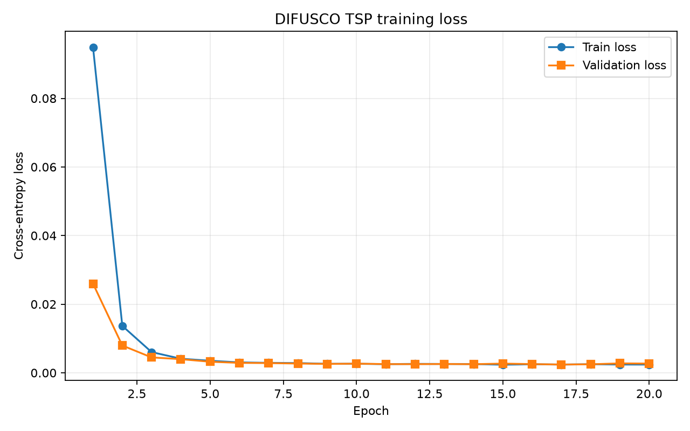
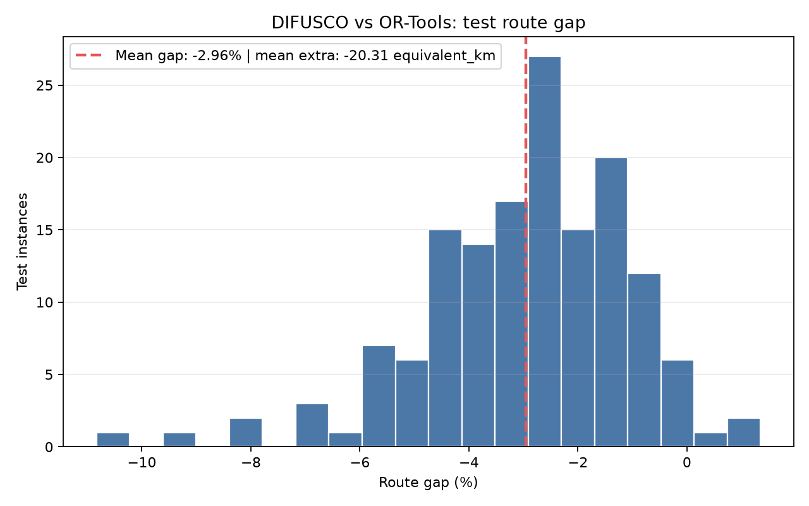

# TSP Diffusion Solver：OSM 路徑成本與 RTX 4090 實驗

本分支完成台中 YouBike **1,000 筆 × 300 節點**的綜合路徑成本資料，以及 RTX 4090 上的 20 輪訓練、150 筆測試與五張圖。程式與完整說明位於下層專案目錄。

- [完整 README：成本公式、結果、環境與重現步驟](TSP-Diffusion-Solver-add-diffusion-model/README.md)
- [向教授報告的順序、講稿與問答](TSP-Diffusion-Solver-add-diffusion-model/PROFESSOR_REPORT.md)
- [模型、指標與完整圖表](TSP-Diffusion-Solver-add-diffusion-model/results/runs/20261111_214014_cost_300nodes_cuda/)
- [完整測資、OSM 圖資與下載校驗方式](TSP-Diffusion-Solver-add-diffusion-model/DATA_DOWNLOADS.md)
- [GitHub 資料完整性檢查](TSP-Diffusion-Solver-add-diffusion-model/GITHUB_DATA_CHECK.md)

## 結果摘要

| 項目 | 結果 |
| --- | ---: |
| 資料切分（train / validation / test） | 700 / 150 / 150 |
| 每筆節點 | 300 |
| Mean gap | **-2.9553%** |
| P95 gap | -0.3834% |
| 低於 OR-Tools 參考成本 | 146 / 150 |
| 有效測試路線 | 150 / 150 |

成本包含道路距離、靜態行車時間、收費路段與號誌，單位為等效公里。結果為**模型＋解碼器相對每筆限時 30 秒的 OR-Tools 參考值**；不代表全域最優或相同運算時間下優於 OR-Tools。完整測資約 973 MiB，與原始／預處理 OSM 道路資料已補至 [GitHub Release](https://github.com/aaaaa0723/TSP-Diffusion-Solver/releases/tag/cost-data-2026-11-11-v1)，含 SHA-256。大型檔案不納入 Git 歷史；模型、設定、測試指標及五張圖保存在本分支。

## 圖表

道路比較：[最佳案例](TSP-Diffusion-Solver-add-diffusion-model/results/runs/20261111_214014_cost_300nodes_cuda/best_case_comparison.png) · [平均案例](TSP-Diffusion-Solver-add-diffusion-model/results/runs/20261111_214014_cost_300nodes_cuda/average_case_comparison.png) · [最差案例](TSP-Diffusion-Solver-add-diffusion-model/results/runs/20261111_214014_cost_300nodes_cuda/worst_case_comparison.png)
