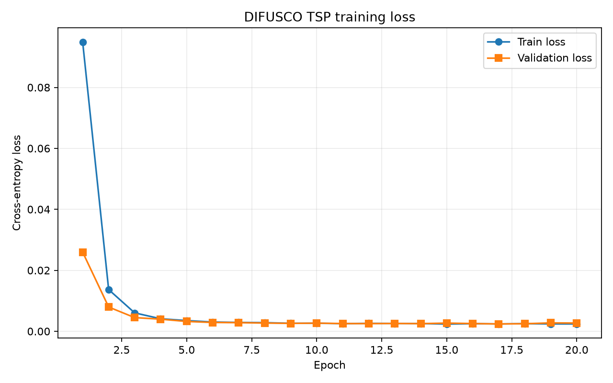
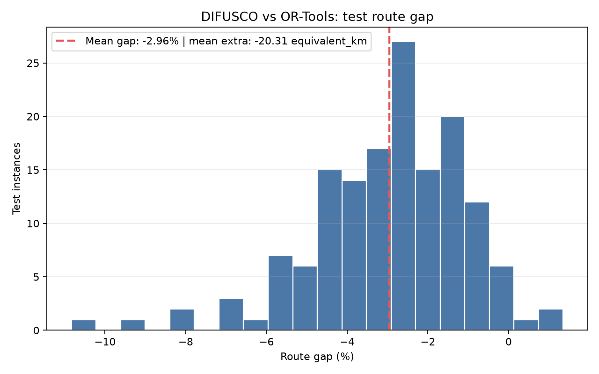

# DIFUSCO：台中 YouBike 綜合路徑成本實驗

以 PyTorch 實作精簡的 categorical edge diffusion 與 GNN，再以道路成本解碼器產生完整 TSP 巡迴。本次問題仍是 TSP，但最佳化目標已由單純距離改為「道路距離＋行駛時間＋收費路段＋號誌」的綜合成本。

## 本次已完成的實驗

| 項目 | 設定／結果 |
| --- | --- |
| Run | `20261111_214014_cost_300nodes_cuda` |
| 資料 | 台中 YouBike；1,000 筆，每筆 300 個站點 |
| 切分 | 700 train / 150 validation / 150 test，seed 42 |
| 參考解 | OR-Tools，每筆最多搜尋 30 秒 |
| 訓練 | RTX 4090、20 epochs、hidden 16、2 層 GNN |
| Diffusion | 32 steps；推論 8 steps |
| 解碼 | `road_multistart`，16 個候選、最多 200 次局部搜尋移動 |
| 最佳驗證損失 | 0.00240646（第 17 輪）；依 validation loss 選取權重 |
| Mean gap | **-2.9553%** |
| P95 gap | **-0.3834%** |
| 平均模型＋解碼器成本 | 660.3418 equivalent_km |
| 平均 OR-Tools 參考成本 | 680.6493 equivalent_km |
| 平均成本差 | -20.3076 equivalent_km |
| 路線有效性 | **150 / 150** 均為完整閉合巡迴 |
| 優於參考解的案例 | 146 / 150 |

Gap = `(模型＋解碼器成本 − OR-Tools 參考成本) / OR-Tools 參考成本 × 100%`，mean gap 為逐筆 gap 的平均。負值表示低於該次限時參考解，**不代表已證明全域最優，也不代表同運算時間下優於 OR-Tools**。這是混合方法的結果，尚未透過消融實驗分離模型與局部搜尋各自的貢獻。

訓練、評估與產圖合計約 592.84 秒；這不是單筆推論時間，也不是單純 GPU 訓練時間。

## 圖表與模型

| 圖表 | 檔案 |
| --- | --- |
| 訓練／驗證損失 | [loss_curve.png](results/runs/20261111_214014_cost_300nodes_cuda/loss_curve.png) |
| 測試 gap 分布 | [mean_gap_histogram.png](results/runs/20261111_214014_cost_300nodes_cuda/mean_gap_histogram.png) |
| 最佳案例 | [best_case_comparison.png](results/runs/20261111_214014_cost_300nodes_cuda/best_case_comparison.png) |
| 最接近平均 gap 的案例 | [average_case_comparison.png](results/runs/20261111_214014_cost_300nodes_cuda/average_case_comparison.png) |
| 最差案例 | [worst_case_comparison.png](results/runs/20261111_214014_cost_300nodes_cuda/worst_case_comparison.png) |





路線圖沿用台中市界、OSRM 道路幾何與站點標示；灰色為 OR-Tools，紅色為模型＋解碼器。最佳、平均、最差案例均從全部 150 筆測試資料中選取。

同一 run 目錄包含：

- `difusco_tsp.pth`：驗證集選出的模型權重。
- `params.json`：完整設定與驗證／測試索引。
- `report.json`：20 輪損失與訓練報告。
- `gap_metrics.json`：全部 150 筆測試的彙總指標。
- `plot_records.json`：逐筆路線、成本、實際道路公里數。
- `road_geometry/`：繪圖使用的道路幾何快取。
- `dataset_validation.json`：完整資料集的驗證結果。
- `reproducibility.json`：資料集 SHA-256、環境版本與產物雜湊。

向教授報告的順序、口頭說法與限制，見 [PROFESSOR_REPORT.md](PROFESSOR_REPORT.md)。

## 成本公式與資料來源

```text
C(i,j) = 0.35 × distance_km(i,j)
       + 0.65 × duration_seconds(i,j) × k
       + 0.25 × toll_km(i,j)
       + 0.02 × signal_counts(i,j)

k = median(正值道路距離) / median(正值行駛時間)
```

`k` 以每筆樣本中距離與時間均為正的非對角配對校準。距離／時間的基礎權重為 35% / 65%；收費與號誌是額外懲罰，四項並不是合計 100% 的比例。權重為人工政策設定，尚未經參數敏感度分析。

- `distances`：實際道路距離，單位 km；`durations`：OSRM 靜態行車時間，單位秒。
- `toll_km`：OSM 收費路段長度；不是實際通行費金額。
- `signal_counts`：OSRM 路線實際經過的 `highway=traffic_signals` 節點次數；不是實際停等秒數。
- `costs`：綜合目標，單位 **equivalent_km（等效公里）**，不可直接稱為實際公里、秒或金額。
- 收費標籤優先序：`toll:motorcar` → `toll:motor_vehicle` → `toll`。
- `cost_metadata_json` 保存權重、時間換算係數與來源資訊；`cost_mode=osm_distance_duration_toll_signals_v3`。

站點取自 [台中 YouBike 開放資料](https://data.gov.tw/en/datasets/136781)，快照為 `data/taichung_youbike.json`。OSRM `driving` 模擬服務車輛行駛，不是自行車路線。OSM 圖資使用 `taiwan-260925` 快照；道路與號誌資料來自 OpenStreetMap contributors，依 ODbL 1.0 使用。

距離、時間、收費與號誌全部取自**同一條 annotated OSRM Route**，避免 Table 與 Route 選到不同等時路線後混用成本。資料生成、OR-Tools、訓練特徵、解碼與評估均使用同一個 `costs` 目標，並保留原始距離供分析。舊資料若沒有 `costs`，既有流程仍使用其距離目標；新舊目標的結果不可直接混比。

目前不包含即時交通、實際號誌週期、實際收費、坡度或路面品質。OSM 標籤缺漏會影響特徵涵蓋率。模型以對稱邊標籤學習，但道路成本可有方向性，最後以有向成本解碼和評分。

## 完整資料下載

完整測資與原始／預處理道路資料：[Release 附件與校驗步驟](DATA_DOWNLOADS.md)。已補上實際訓練環境的 [Linux/CUDA 固定套件清單](code/requirements-training-linux-cu128.txt)。

## 安裝與執行

以下命令在本 README 所在的專案目錄執行。儲存庫根目錄下另有一層 `TSP-Diffusion-Solver-add-diffusion-model/`。

```bash
cd TSP-Diffusion-Solver-add-diffusion-model
python3 -m venv .venv
source .venv/bin/activate
# CUDA 版 PyTorch；本次環境使用 torch 2.11.0+cu128
python -m pip install 'torch>=2.5,<3' --index-url https://download.pytorch.org/whl/cu128
python -m pip install -r code/requirements.txt
# 只有從 PBF 建立本機道路特徵索引時才需要
python -m pip install osmium
```

Windows 可使用 `setup_windows.ps1` 建立環境；CUDA 可用性須另外確認。正式成本訓練 runner 會拒絕無 CUDA 的環境，避免不小心改在 CPU 長時間訓練。

### 1. 準備相同的道路圖資

完整資料集約 973 MiB，OSM PBF、OSRM 圖資、特徵索引**不納入 Git 歷史，已改由 GitHub Release 附件提供**。完整 NPZ 與道路重現資料包均可下載，含 SHA-256；請依 [DATA_DOWNLOADS.md](DATA_DOWNLOADS.md) 下載並放到程式使用的位置。模型、指標與五張圖則直接保存在本分支。衍生快取與逐筆檢查點不另發布。

本次使用 OSRM **v26.9.0**，固定映像：

```text
ghcr.io/project-osrm/osrm-backend@sha256:8a1b1bc938412f15f9b5b32d794c4ec6bf4a85dfbbabfa0a014b70b187edb53b
```

將以相同版本及 driving profile 預處理的 `taiwan-260925.osrm.*` 放入 `data/osrm/`，再啟動：

```bash
docker compose -f docker-compose.osrm.yml up -d
```

主機沒有 Docker 時可使用 Podman 執行相同映像，將道路檔案掛載到 `/data`，以 `osrm-routed --algorithm mld --max-table-size 1000 /data/taiwan-260925.osrm` 啟動。本次遠端採用 rootless Podman。請勿使用舊 `osrm/osrm-backend` 映像讀取 v26.9.0 圖資。

使用**同一份 PBF**建立特徵索引：

```bash
python code/extract_osm_costs.py /path/to/taiwan-260925.osm.pbf data/osm_cost_index_260925
```

`run_cost_generation.py` 使用上述索引路徑與固定快取命名空間；若改用其他快照，必須同步調整索引及快取版本並建立新資料集，不能混用舊檢查點。

### 2. 生成與驗證完整測資

```bash
python -B -u code/run_cost_generation.py
```

流程為 30 節點 smoke test → 1,000 × 300 正式生成 → 全資料驗證。每完成一筆即保存檢查點；中斷後以相同設定執行同一個 runner 可續跑。

- 輸出：`results/tsp_dataset_youbike_300nodes_toll_signals.npz`
- 進度：`results/generation_toll_signals/status.json`
- 紀錄：`results/generation_toll_signals/generating.log`
- 成功條件：`phase=complete`，包含成本公式與完整巡迴驗證；僅看到程序啟動不等於資料完成。

一般入口 `generate_tsp.py` 預設為 1,000 × 300、每筆 30 秒，但預設輸出是 `results/tsp_dataset_youbike.npz`，與本次專用 runner 的路徑不同。

### 3. CUDA 訓練、評估與五張圖

```bash
python -B -u code/run_cost_training.py
```

runner 會先檢查 CUDA、完成一個小型訓練／評估／五圖流程，再正式訓練 20 輪；每輪評估全部 150 筆 validation，以最低 validation loss 選取 checkpoint，最後評估全部 150 筆 test。僅在五張 PNG 均可讀、模型存在、測試路線有效時回報 `phase=complete`。

進度與 log 位於 `results/training_toll_signals/`；結果寫入新的 `results/runs/<timestamp>_cost_300nodes_cuda/`，不覆蓋舊 run。完成後才更新 `results/runs/latest.txt`。

SSH 工作建議使用：

```bash
tmux new -s tsp-training
python -B -u code/run_cost_training.py
# Ctrl+B，再按 D，可離開並讓工作繼續
# 下次登入：tmux attach -t tsp-training
```

### 4. 重畫已保存的路線圖

```bash
python code/evaluate.py --run 20261111_214014_cost_300nodes_cuda --plots-only
```

已有 `plot_records.json` 和相同 URL 對應的幾何快取時，可重畫三張路線圖而不重新訓練；缺快取時仍需 OSRM。`--plots-only` 不重新生成 loss curve 或 gap histogram。若要重新評估模型，另需完整 NPZ：

```bash
export TSP_DATASET_PATH="$PWD/results/tsp_dataset_youbike_300nodes_toll_signals.npz"
python code/evaluate.py --run 20261111_214014_cost_300nodes_cuda --samples 0
```

## 驗證與後續工作

```bash
python -B -m unittest discover -s code -p test_store_generation.py
python -B -m unittest discover -s code -p test_decoder.py
```

現有 16 項測試已通過；已完成的真實驗證包括：1,000 × 300 資料成本／巡迴驗證、CUDA smoke test、正式 20 輪訓練、150 筆測試路線有效性與五張圖完整性檢查。

後續應補上：相同運算時間的 OR-Tools 比較、距離／時間／收費／號誌消融、成本權重敏感度、模型與 decoder 分別貢獻，以及跨地區／跨站點驗證。同站點池抽樣的 70/15/15 切分不等於對全新地區的泛化測試。

## 既有實驗與方法來源

先前 7-ELEVEN、蝦皮案例與其他 run 保留於 `results/`；其資料、節點數、評估筆數與目標可能不同，請分別閱讀各 run 的 `params.json`，不要將舊的距離指標與本次成本指標直接混合。

本專案參考 [DIFUSCO](https://github.com/Edward-Sun/DIFUSCO) 的 categorical diffusion 與 gated edge-GNN 設計，是自包含的精簡實作，不是官方 checkpoint 或官方程式碼的直接移植。方法來源：[Graph-based Diffusion Solvers for Combinatorial Optimization](https://arxiv.org/abs/2302.08224)。
